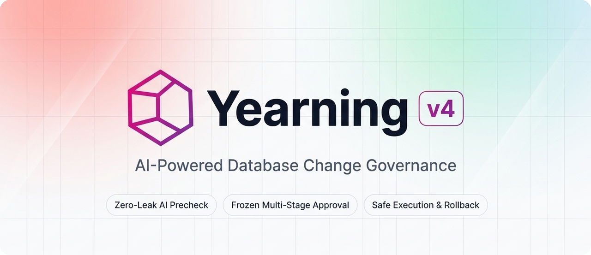
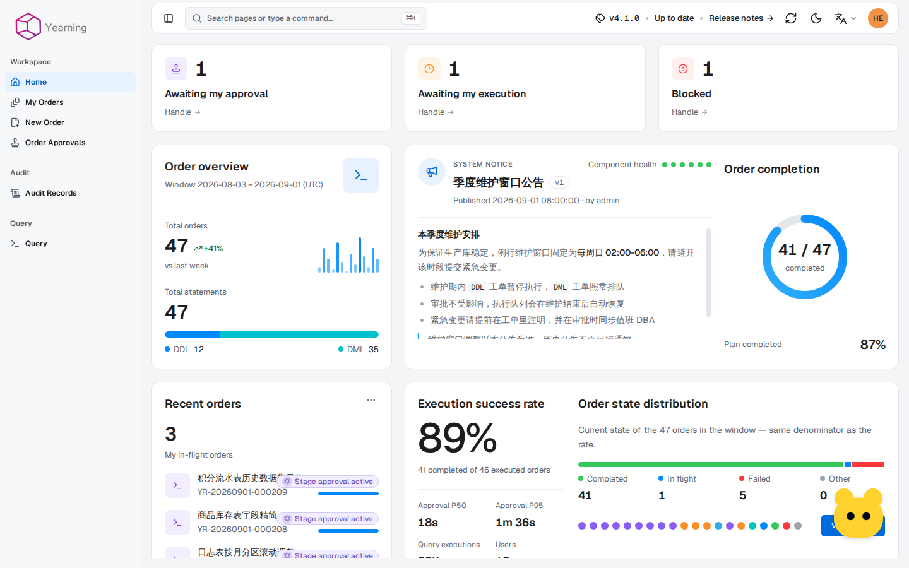
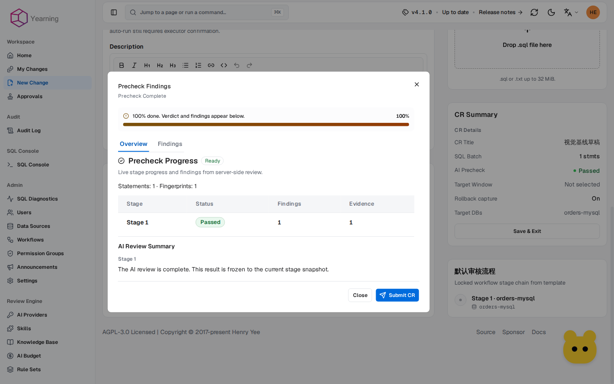
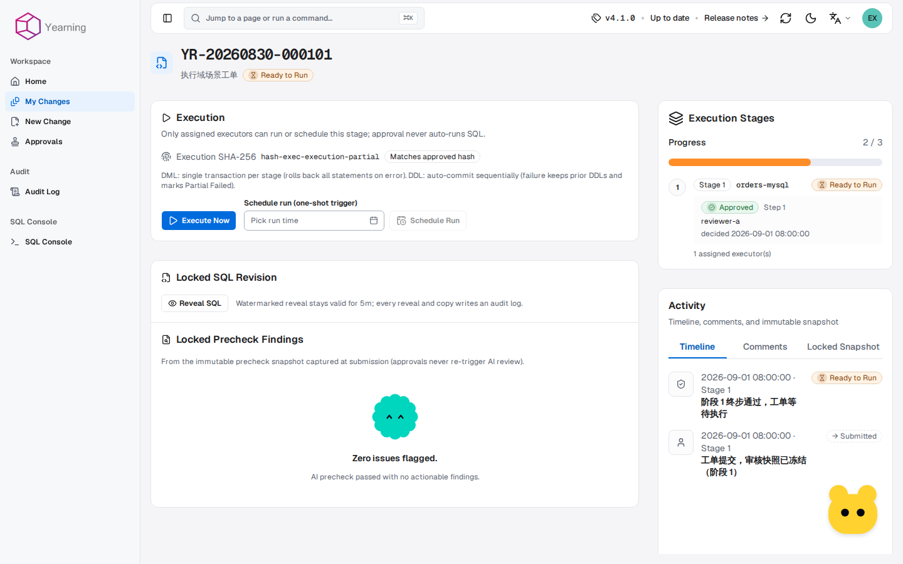
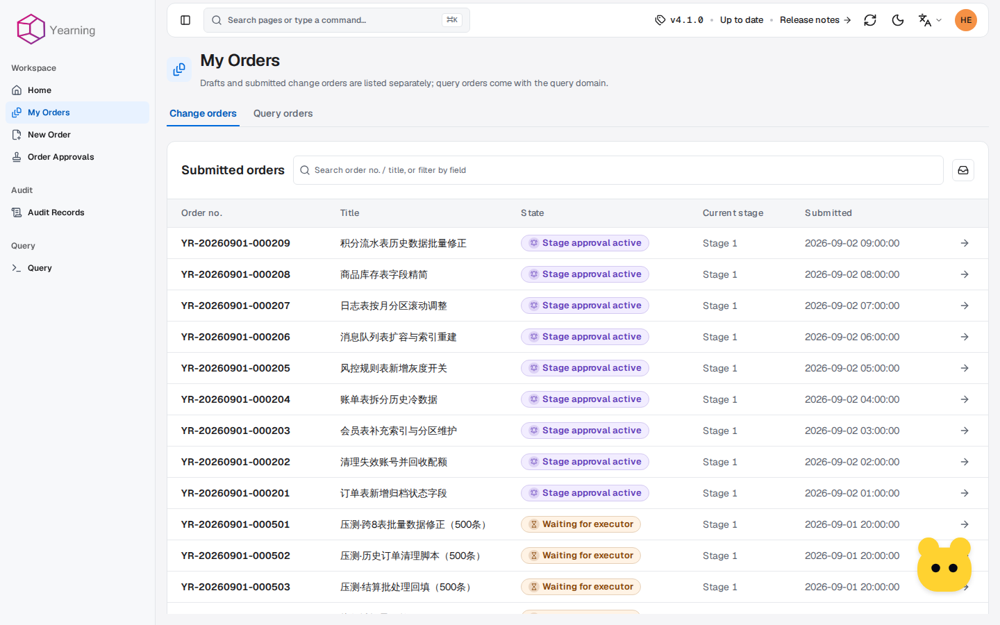
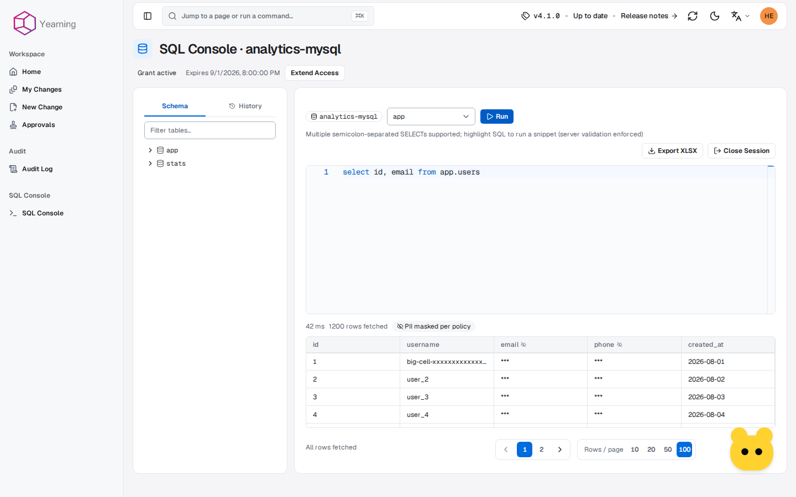
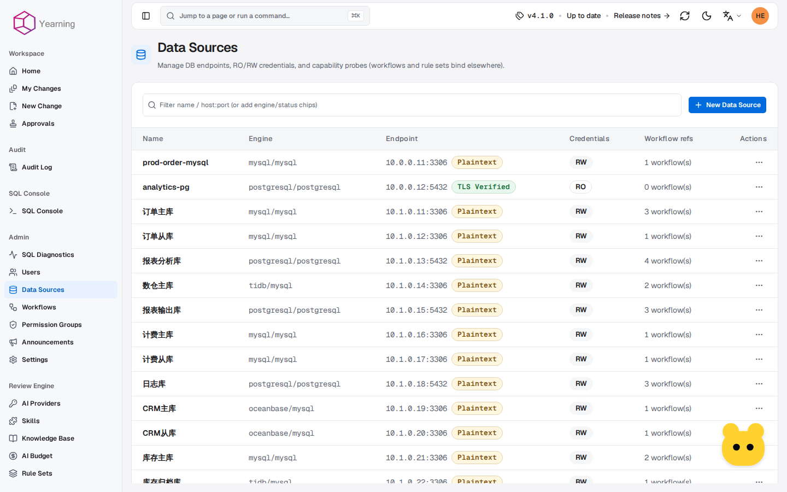
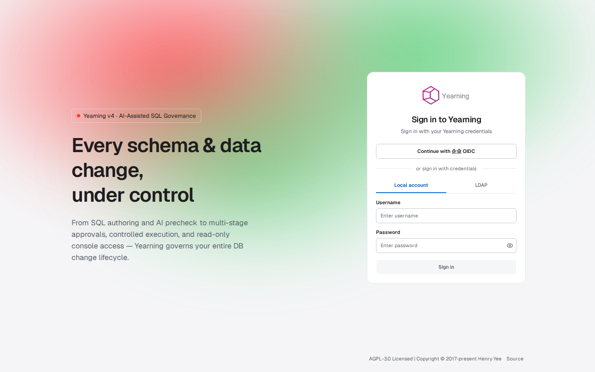
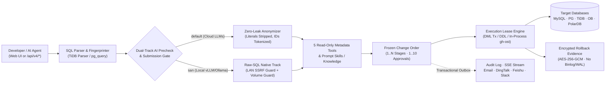

<div align="center"><a name="readme-top"></a>

<a href="https://v4.yearning.io" target="_blank">
  <picture>
    <source media="(prefers-color-scheme: dark)" srcset="./assets/readme/hero-banner-dark.png">
    
  </picture>
</a>

# Yearning

**AI-Powered Database Change Governance & SQL Review Platform**

Every SQL change, safely under control.<br/>
From zero-leak AI precheck and frozen multi-stage approvals to in-process `gh-ost` online DDL, cross-engine rollback, governed queries, and SQL performance diagnostics.

**English** · [简体中文](./README.zh-CN.md) · [Live Demo][demo-link] · [Documentation][docs-link] · [Releases][github-release-link] · [Discussions][github-discussions-link] · [Feedback][github-issues-link] · [Sponsor][sponsor-link]

<br/>

[![][demo-shield-badge]][demo-link] [![][docs-shield-badge]][docs-link]

<!-- SHIELD GROUP -->

[![][github-release-shield]][github-release-link]
[![][docker-ghcr-shield]][docker-ghcr-link]
[![][go-version-shield]][go-version-link]
[![][react-version-shield]][react-version-link]
[![][postgres-shield]][postgres-link]<br/>
[![][github-stars-shield]][github-stars-link]
[![][github-forks-shield]][github-forks-link]
[![][github-issues-shield]][github-issues-link]
[![][github-contributors-shield]][github-contributors-link]
[![][github-license-shield]][github-license-link]<br/>

**Share Yearning Repository**

[![][share-x-shield]][share-x-link]
[![][share-telegram-shield]][share-telegram-link]
[![][share-whatsapp-shield]][share-whatsapp-link]
[![][share-reddit-shield]][share-reddit-link]
[![][share-weibo-shield]][share-weibo-link]
[![][share-linkedin-shield]][share-linkedin-link]

</div>

<details>
<summary><kbd>Table of contents</kbd></summary>

#### TOC

- [👋🏻 Getting Started & Community](#-getting-started--community)
- [✨ Features](#-features)
  - [Every SQL change, safely under control](#every-sql-change-safely-under-control)
  - [`01` Zero-Leak AI SQL Precheck & Submission Gate](#01-zero-leak-ai-sql-precheck--submission-gate)
  - [`02` Frozen Multi-Stage Approvals & Execution Control](#02-frozen-multi-stage-approvals--execution-control)
  - [`03` Cross-Engine Automatic SQL Rollback](#03-cross-engine-automatic-sql-rollback)
  - [`04` Governed Read-Only Query Workspace & Data Masking](#04-governed-read-only-query-workspace--data-masking)
  - [`05` SQL Performance Diagnostics & Scoped Database AI Assistant](#05-sql-performance-diagnostics--scoped-database-ai-assistant)
  - [`06` Multi-Engine Governance, Enterprise SSO & Notification Center](#06-multi-engine-governance-enterprise-sso--notification-center)
- [🏗️ Architecture & Privacy Pipeline](#-architecture--privacy-pipeline)
- [🗄️ Supported Database Matrix](#-supported-database-matrix)
- [🤖 AI Agent Skill & OpenAPI](#-ai-agent-skill--openapi)
- [🛳 Self Hosting](#-self-hosting)
  - [`A` Docker Compose (Recommended)](#a-docker-compose-recommended)
  - [`B` Kubernetes Production Deployment](#b-kubernetes-production-deployment)
  - [`C` Migrating from Yearning v3](#c-migrating-from-yearning-v3)
- [⌨️ Local Development](#-local-development)
- [🤝 Contributing](#-contributing)
- [🔐 Security](#-security)
- [❤️ Sponsor](#-sponsor)
- [📝 License](#license)

####

<br/>

</details>

<br/>

<div align="center">
  <picture>
    <source media="(prefers-color-scheme: dark)" srcset="./frontend/tests/screenshots/dashboard-1440-en-US-dark.png">
    
  </picture>
</div>

## 👋🏻 Getting Started & Community

**Yearning v4** is a ground-up architectural rebuild of the open-source Yearning SQL audit and database governance platform. Built as a single-binary **Go modular monolith** paired with a modern **React 19 + shadcn/ui** web workspace and a **PostgreSQL** metadata plane, Yearning v4 eliminates legacy RPC services and introduces a **zero-leak AI SQL Review Engine**, cryptographically frozen multi-stage governance, built-in in-process `gh-ost` Online DDL, binlog-free cross-engine rollback, governed read-only queries, and Top-SQL performance diagnostics.

Whether you are a DBA safeguarding production databases, a platform team standardizing database CI/CD, or an engineering org integrating AI coding agents safely with `/api/v4/*`, Yearning v4 gives you structured, auditable control over the entire database lifecycle.

| Channel | Description |
| :-- | :-- |
| [![][demo-shield-badge]][demo-link] | Interactive pure-browser v4 sandbox (AI SQL Review, AI Assistant, SQL Diagnostics, and role switcher) at **demo.yearning.io**. |
| [![][docs-shield-badge]][docs-link] | Official installation, governance architecture, security model, and operations guides at **v4.yearning.io**. |
| [![][discussions-shield-badge]][github-discussions-link] | Ask questions, share review skills, and discuss v4 architecture with maintainers and the community. |
| [![][issues-shield-badge]][github-issues-link] | Report bugs, request database adapters, or propose enhancements on GitHub Issues. |
| [![][email-shield-badge]][email-link] | Enterprise licensing, commercial support, and partnership inquiries: **henry@yearning.io**. |

> [!IMPORTANT]
>
> **Star Us** to receive every Yearning v4 release notification without delay! ⭐️

<details>
  <summary><kbd>Star History</kbd></summary>
  <picture>
    <source media="(prefers-color-scheme: dark)" srcset="https://api.star-history.com/svg?repos=cookieY%2FYearning&theme=dark&type=Date">
    
  </picture>
</details>

<div align="right">

[![][back-to-top]](#readme-top)

</div>

## ✨ Features

<div align="center">

### Every SQL change, safely under control

AI analyzes risk and synthesizes evidence — structured governance owns every approval, execution, and audit trail.

<sub>WHAT MAKES YEARNING V4 DIFFERENT</sub>

</div>

<table>
  <tr>
    <td width="50%" valign="top">
      <b>🛡️ Zero-Leak AI Precheck</b><br/>
      Canonical SQL fingerprinting collapses up to 100k statements, strips literals & comments, anonymizes identifiers in memory, and enforces a non-bypassable Submission Gate.
    </td>
    <td width="50%" valign="top">
      <b>🔒 Frozen Multi-Stage Governance</b><br/>
      Serial <code>1..N</code> datasource stages and <code>1..10</code> approval steps cryptographically frozen at submission — even <code>admin</code> cannot bypass, reassign, or override an order.
    </td>
  </tr>
  <tr>
    <td width="50%" valign="top">
      <b>⚡ In-Process <code>gh-ost</code> &amp; Auto Rollback</b><br/>
      Built-in Go <code>gh-ost</code> online DDL with live copy progress plus binlog-free DML/DDL before-image rollback across both MySQL and PostgreSQL.
    </td>
    <td width="50%" valign="top">
      <b>🔍 Governed Query &amp; SQL Diagnostics</b><br/>
      Time-bounded read-only Query Grants with server-side column masking, streaming exports, plus 6-chart Top SQL diagnostics with 4-section AI root-cause reports.
    </td>
  </tr>
</table>

---

### `01` Zero-Leak AI SQL Precheck & Submission Gate

Every DDL/DML change order must pass a deterministic + AI two-stage precheck before submission. Yearning lexes each SQL batch (up to **100,000 statements / 32 MiB**), computes **Canonical & Dialect Fingerprints**, and collapses homologous statements into fingerprint groups (up to **1,000 distinct groups** per order) so the AI Review Agent inspects only **1 representative anonymized SQL per group**.

- **5 Read-Only Agent Tools**: `check_syntax`, `describe_table`, `list_indexes`, `table_stats`, and `safe_explain` inspect real schema metadata and execution plans without ever mutating data.
- **Dual-Track AI Privacy Isolation**:
  - **`default` Track (Cloud OpenAI-Compatible APIs)**: 100% in-memory anonymization of SQL literals, comments, and identifiers (`schema_1`, `table_1`, `column_1`) with fail-closed zero-leak assertions and audited identifier restoration for authorized reviewers.
  - **`san` Track (Local Self-Hosted Models via vLLM / Ollama)**: Compact Raw-SQL Native prompts on internal RFC1918 LAN endpoints with SSRF protection (`addrguard`) and strict cross-profile isolation so raw payloads never fall back to public cloud providers.
- **Custom Prompt Skills & Enterprise Knowledge Base**: Manage built-in and custom Prompt Tools, bind `global` / `datasource` / `table`-scoped Internal Experience rules, and enforce a **Critical Submission Gate** where policy violations or runtime-proven invalid statements always block submission.
- **Global Daily AI Cost Budget**: Multi-window `CNY` / `USD` reference pricing and a single global daily cost budget with failover across contract-compatible providers.

<picture>
  <source media="(prefers-color-scheme: dark)" srcset="./frontend/tests/screenshots/precheck-1440-en-US-dark.png">
  
</picture>

<div align="right">

[![][back-to-top]](#readme-top)

</div>

### `02` Frozen Multi-Stage Approvals & Execution Control

Configure `change_review` flows with **`1..N` serial datasource stages** (for example, Staging → Production), **`1..10` serial approval steps** per stage, and explicit **execution actors**.

- **Immutable Snapshot at Submission**: Rules, stages, datasources, approvers, executors, SQL SHA-256 hash, and full AI Review snapshots are frozen server-side. No role — including `admin` — can edit, delegate, skip, or override a submitted order.
- **Watermarked Audited SQL Reveal**: Order SQL is encrypted at rest with **AES-256-GCM** and omitted from default list/detail responses. Viewing plaintext triggers an explicit audited reveal carrying a traceable viewer watermark (`username + timestamp + trace_id`).
- **Safe Execution & In-Process `gh-ost` Online DDL**:
  - **Approval never auto-executes** — frozen executors trigger immediate execution or create a one-shot scheduled run (within a 15-minute grace window and optional weekly maintenance windows).
  - **Single-Datasource Execution Lease** prevents concurrent conflicting changes on the same database.
  - **Built-in `gh-ost` (`github.com/github/gh-ost`)** runs directly in-process for native MySQL 5.7/8.0 `ALTER TABLE` changes with 18 tunable safety parameters and real-time table-copy progress — no external binary required.
  - **Fail-Closed `result_unknown` Recovery**: Network drops during commit never blindly replay SQL; executors inspect the target database and record an audited manual verification (`confirm_succeeded` / `confirm_failed`).

<picture>
  <source media="(prefers-color-scheme: dark)" srcset="./frontend/tests/screenshots/detail-1440-en-US-dark.png">
  
</picture>

<picture>
  <source media="(prefers-color-scheme: dark)" srcset="./frontend/tests/screenshots/list-1440-en-US-dark.png">
  
</picture>

<div align="right">

[![][back-to-top]](#readme-top)

</div>

### `03` Cross-Engine Automatic SQL Rollback

Yearning v4 replaces fragile MySQL-only binlog scraping with a **zero-Binlog / zero-WAL cross-engine AST & before-image rollback architecture** spanning both MySQL-compatible and PostgreSQL-compatible engines.

- **In-Transaction DML Capture**: Captures exact row before-images during execution (up to **100,000 rows per statement and per order**; automatically aborts and rolls back the forward transaction if exceeded so changes never commit without complete rollback coverage).
- **Structural DDL & `gh-ost` Snapshots**: Captures pre/post schema metadata for reversible DDL (`CREATE`/`DROP`/`ALTER TABLE`, `ADD`/`DROP COLUMN`, `RENAME`, `INDEX`, `CONSTRAINT`, and `gh-ost` `ALTER TABLE`) and reconstructs inverse DDL.
- **Governed Rollback Orders**: Reverse SQL is stored encrypted at rest (`AES-256-GCM`). One click generates a linked Rollback Order that passes standard AI Precheck, approval, and post-execution drift verification — never bypassing governance.

<div align="right">

[![][back-to-top]](#readme-top)

</div>

### `04` Governed Read-Only Query Workspace & Data Masking

Give developers and analysts self-service database read access without handing out raw database credentials.

- **Approval-Gated Query Grants**: Request time-bounded access to authorized datasources via `query_access` flows (or open direct sessions when approval is disabled). Approvers or admins can revoke any active grant instantly, with real-time **SSE (`GET /api/v4/events/stream`)** session lock push.
- **Strict Read-Only AST Guard**: Validates every query (`SELECT`, `WITH ... SELECT`, `SHOW`, `DESCRIBE`, `EXPLAIN`) server-side inside read-only transactions with configurable statement timeouts (`1..300,000 ms`).
- **Server-Side Sensitive Column Masking**: Apply per-flow masking rules so PII columns (`email`, `phone`, `id_card`, etc.) are masked before bytes ever leave the server.
- **Streaming Cursors & Governed Export**: HMAC-signed streaming cursors (up to **5,000 rows/page**, **6-hour TTL**) with Monaco schema-aware autocomplete and browser-side **XLSX / CSV / JSONL** export strictly controlled by per-datasource `can_export` grants.

<picture>
  <source media="(prefers-color-scheme: dark)" srcset="./frontend/tests/screenshots/query-1440-en-US-dark.png">
  
</picture>

<div align="right">

[![][back-to-top]](#readme-top)

</div>

### `05` SQL Performance Diagnostics & Scoped Database AI Assistant

- **SQL Performance Diagnostics (`/admin/diagnostics`)**:
  - Collects native statement digest statistics from **`performance_schema`** (MySQL) and **`pg_stat_statements`** (PostgreSQL) strictly over read-only credentials — zero intrusive extensions or counter resets.
  - **6 Interactive Overview Charts** (Total Time, Calls, Avg Latency, Rows Examined / Shared Blocks Read, Lock Wait, Errors) with an interactive **Brush time selector** to zoom into latency spikes and inspect Top SQL fingerprints.
  - **4-Section AI Diagnosis**: Generates structured **Root Cause Analysis**, **Index Recommendations**, **SQL Rewrites**, and **Verification Steps** — and sends recommended index DDL directly into AI Precheck & Change Orders.
- **Scoped Database AI Assistant**:
  - Always-available in-app database assistant strictly scoped to three safe tasks: **(1) Platform & Governance Q&A**, **(2) Metadata-Grounded NL-to-SQL Generation**, and **(3) SQL Analysis & Optimization**.
  - Enforces single-turn in-memory desensitization and AST restoration, never accesses business table row data, and never executes SQL directly — generated drafts always enter formal AI Precheck and approval.

<div align="right">

[![][back-to-top]](#readme-top)

</div>

### `06` Multi-Engine Governance, Enterprise SSO & Notification Center

- **Multi-Engine Datasource Registry**: Manage MySQL, PostgreSQL, TiDB, OceanBase, and PolarDB instances with separated **Read-Only (`review`/`query`)** and **Read-Write (`execution`)** credentials, verified TLS PEM materials, capability probes, and AEAD encryption at rest.
- **Enterprise Authentication**: Local accounts, singleton **LDAP (`LDAPS` / `StartTLS` with mandatory TLS verification)**, and multi-provider **OIDC SSO (Authorization Code + PKCE `S256`)**.
- **Notification Center**: Transactional outbox delivery across **Email (SMTP)**, **DingTalk**, **Feishu**, and **Slack** with deterministic routing rules, allowlisted `{{placeholder}}` custom templates, live preview, deduplication, 5-attempt backoff retries, and guaranteed zero SQL/credential leakage.
- **Immutable Compliance Trail**: 90-day append-only audit logs covering every authentication, precheck, identifier reveal, SQL reveal, approval, execution, rollback, query, export, and admin mutation, while permanently preserving business order/approval/execution facts.

<picture>
  <source media="(prefers-color-scheme: dark)" srcset="./frontend/tests/screenshots/admin-1440-en-US-dark.png">
  
</picture>

<picture>
  <source media="(prefers-color-scheme: dark)" srcset="./frontend/tests/screenshots/login-en-US-dark.png">
  
</picture>

<div align="right">

[![][back-to-top]](#readme-top)

</div>

## 🏗️ Architecture & Privacy Pipeline

Yearning v4 runs as a **stateless Go modular monolith** backed by **PostgreSQL** — no RPC daemons, no local pod state, and clean horizontal multi-replica scaling on Kubernetes.



| Layer | Technology |
| :-- | :-- |
| **Backend** | Go `1.26` · Gin · GORM · `pgx/v5` · TiDB SQL Parser · `pg_query_go/v6` · In-Process `gh-ost` · Zero RPC |
| **Frontend** | React `19` · TypeScript `6` · Vite `8` · Tailwind CSS `v4` · shadcn/ui · Base UI · Monaco Editor · Recharts |
| **Metadata & Security** | PostgreSQL `14–18` · AES-256-GCM AEAD Keyring · Double-Submit CSRF · OIDC PKCE (`S256`) · LDAPS/StartTLS |
| **Container & Runtime** | Distroless Static Non-Root (`linux/amd64`, `linux/arm64`) · Read-Only RootFS · Kubernetes Multi-Replica |

<div align="right">

[![][back-to-top]](#readme-top)

</div>

## 🗄️ Supported Database Matrix

| Engine | Compatibility Mode | AI SQL Review | Change Execution | In-Process `gh-ost` | Auto Rollback | Governed Query | Perf Diagnostics |
| :-- | :-- | :-: | :-: | :-: | :-: | :-: | :-: |
| **MySQL 5.7 / 8.0** | Native MySQL | ✅ | ✅ | ✅ | ✅ | ✅ | ✅ (`performance_schema`) |
| **PostgreSQL 14 – 18** | Native PostgreSQL | ✅ | ✅ | — | ✅ | ✅ | ✅ (`pg_stat_statements`) |
| **TiDB** | MySQL Mode | ✅ | ✅ | — | ✅ | ✅ | ✅ |
| **OceanBase** | MySQL Mode | ✅ | ✅ | — | ✅ | ✅ | ✅ |
| **PolarDB** | MySQL &amp; PG Mode | ✅ | ✅ | — | ✅ | ✅ | ✅ |

> [!NOTE]
>
> Yearning's own metadata store officially runs on **PostgreSQL** (PostgreSQL 18 is pre-configured in `docker-compose.yml`).

<div align="right">

[![][back-to-top]](#readme-top)

</div>

## 🤖 AI Agent Skill & OpenAPI

Yearning v4 ships with a complete **OpenAPI 3 specification** ([`api/openapi/yearning-v4.yaml`](./api/openapi/yearning-v4.yaml)), a real-time **SSE Event Stream** (`GET /api/v4/events/stream`), and an open **`SKILL.md` Agent Skill** ([`skills/yearning/`](./skills/yearning/SKILL.md)) that works out of the box with **Claude Code**, **Codex CLI**, **Antigravity**, and other skill-enabled AI agents — no MCP server or local `yearning` binary required.

| Capability | Included Artifact | What It Enables |
| :-- | :-- | :-- |
| **🧠 Agent Skill (`SKILL.md`)** | [`skills/yearning/SKILL.md`](./skills/yearning/SKILL.md) | Let AI agents discover flows, run AI SQL prechecks, submit/approve/execute orders, run governed `SELECT` queries, and run SQL diagnostics safely under full RBAC & Submission Gate guardrails. |
| **🐍 Zero-Dependency CLI Helper** | [`skills/yearning/scripts/yearning_api.py`](./skills/yearning/scripts/yearning_api.py) | Python 3 stdlib helper handling session cookies, double-submit `X-CSRF-Token`, `Idempotency-Key`, optimistic concurrency (`If-Match`), and audited SQL reveals automatically. |
| **📜 OpenAPI 3 Specification** | [`api/openapi/yearning-v4.yaml`](./api/openapi/yearning-v4.yaml) | Generate typed clients, integrate CI/CD pipelines, or subscribe to user-scoped `io.yearning.v4.*` SSE events via `GET /api/v4/events/stream`. |

```bash
export YEARNING_BASE_URL="http://localhost:8080"
export YEARNING_USERNAME="admin"
export YEARNING_PASSWORD_FILE="/path/to/password"

# Discover granted flows & run AI SQL Precheck
python3 skills/yearning/scripts/yearning_api.py flows
python3 skills/yearning/scripts/yearning_api.py precheck \
  --flow-id <flow_id> \
  --sql "ALTER TABLE demo.users ADD COLUMN status VARCHAR(32) NOT NULL DEFAULT 'active';"

# Run governed read-only SELECT with automatic server-side column masking
python3 skills/yearning/scripts/yearning_api.py query \
  --datasource-id <datasource_id> \
  --schema-name app \
  --sql "SELECT id, email, created_at FROM users LIMIT 20"
```

<div align="right">

[![][back-to-top]](#readme-top)

</div>

## 🛳 Self Hosting

Run Yearning v4 on your own infrastructure and keep every schema, credential, and audit trail strictly inside your network perimeter.

### `A` Docker Compose (Recommended)

[![][docker-ghcr-shield]][docker-ghcr-link]

The bundled [`docker-compose.yml`](./docker-compose.yml) bootstraps an all-in-one stack with **PostgreSQL 18**, automatic internal TLS certificates, an **AES-256-GCM AEAD keyring**, schema migrations, and the Yearning v4 control plane + embedded Web UI — zero manual secret crafting needed.

```bash
git clone --single-branch --branch v4 https://github.com/cookieY/Yearning.git
cd Yearning
docker compose up -d
```

Then open **`http://<your-host-ip>:8080`** in your browser:

- **Default Username**: `admin`
- **Default Password**: `Yearning@2026!` *(override before first boot with `YEARNING_ADMIN_PASSWORD`, minimum 12 characters)*

> [!CAUTION]
>
> **Never run `docker compose down -v` during upgrades**: deleting the `yearning_app_secrets` volume destroys the AEAD keyring protecting stored datasource credentials, AI provider keys, and encrypted SQL records.
>
> For production deployments, place Yearning behind an HTTPS reverse proxy, set `YEARNING_SESSION_SECURE=true`, and use the 3-role PostgreSQL privilege separation under [`db/roles/grants.sql`](./db/roles/grants.sql).

### `B` Kubernetes Production Deployment

Yearning v4 ships hardened, distroless, read-only-rootfs Kubernetes manifests under [`backend/deploy/k8s/`](./backend/deploy/k8s/):

- [`backend/deploy/k8s/control-plane.yaml`](./backend/deploy/k8s/control-plane.yaml) — Stateless multi-replica Deployment with liveness/readiness probes and non-root security context.
- [`backend/deploy/k8s/migration-workloads.yaml`](./backend/deploy/k8s/migration-workloads.yaml) — Dedicated schema migration Job isolated from runtime encryption keys.
- [`backend/deploy/k8s/network-policy.yaml`](./backend/deploy/k8s/network-policy.yaml) — Least-privilege cluster NetworkPolicy rules.

### `C` Migrating from Yearning v3

Yearning v4 provides an explicit, versioned offline migration workflow (`yearning migrate` + [`api/migration/`](./api/migration/)) with dry-run verification and interactive permission mapping confirmation (`yearning serve --migration-mode`) — no dual-write risk and no silent schema auto-migration. See the [official migration guide][docs-link] before upgrading existing v3 installations.

<div align="right">

[![][back-to-top]](#readme-top)

</div>

## ⌨️ Local Development

### Prerequisites

- **Go** `1.26+`
- **Node.js** `24.x` & **pnpm** `10.x`
- **PostgreSQL** `14–18` (for full server execution)

### Build & Test

```bash
# Clone the v4 branch
git clone --single-branch --branch v4 https://github.com/cookieY/Yearning.git
cd Yearning

# Backend build & unit tests
make backend-build
make backend-test

# Frontend dependencies, build & unit tests
make frontend-install
make frontend-build
make frontend-test

# Build standalone release container image
make docker-build
```

### Repository Layout

| Directory | Description |
| :-- | :-- |
| [`backend/`](./backend/README.md) | Go modular monolith (`cmd/yearning`, `internal/`, `deploy/k8s/`) |
| [`frontend/`](./frontend/README.md) | React 19 + TypeScript + Vite + Tailwind CSS v4 + shadcn/ui web application |
| [`db/`](./db/) | Versioned PostgreSQL schema migrations (`db/migrations/`) and least-privilege role grants (`db/roles/grants.sql`) |
| [`api/`](./api/) | OpenAPI 3 specification (`api/openapi/yearning-v4.yaml`), migration mappings, and runtime contracts |
| [`docker/`](./docker/) & [`docker-compose.yml`](./docker-compose.yml) | Distroless multi-arch release Dockerfile and all-in-one Docker Compose stack |
| [`skills/yearning/`](./skills/yearning/SKILL.md) | Zero-dependency AI Agent Skill (`SKILL.md` + Python helper) for `/api/v4/*` |

<div align="right">

[![][back-to-top]](#readme-top)

</div>

## 🤝 Contributing

Contributions of all kinds — bug fixes, database adapter enhancements, UI improvements, documentation, and review skills — are warmly welcome!

Please read our [**Contributing Guide**](./CONTRIBUTING.md) and [**Contributor License Agreement (CLA)**](./CLA.md) before opening a pull request.

[![][pr-welcome-shield]][pr-welcome-link]
[![][issues-shield-badge]][github-issues-link]

<a href="https://github.com/cookieY/Yearning/graphs/contributors" target="_blank">
  
</a>

<div align="right">

[![][back-to-top]](#readme-top)

</div>

## 🔐 Security

Security is foundational to Yearning v4. If you discover a security vulnerability, **please report it privately** following [`SECURITY.md`](./SECURITY.md) instead of opening a public GitHub issue.

<div align="right">

[![][back-to-top]](#readme-top)

</div>

## ❤️ Sponsor

Yearning has been built and maintained openly since 2017. If Yearning helps safeguard your team's production databases, consider supporting its ongoing development — every sponsorship directly fuels new database adapters, AI review research, and community maintenance.

[![][sponsor-shield-badge]][sponsor-link]

For commercial licensing, enterprise support, or private deployment consulting, contact **<henry@yearning.io>**.

<div align="right">

[![][back-to-top]](#readme-top)

</div>

---

<a id="license"></a>

<details><summary><h4>📝 License</h4></summary>

Yearning v4 is dual-licensed:

- **Open Source**: Licensed under the **GNU Affero General Public License v3.0 or later ([AGPL-3.0-or-later](./LICENSE))**. Any derivative work or network-accessible modified deployment must strictly comply with AGPL-3.0 terms (including Section 13 source availability).
- **Commercial License**: Separate commercial licenses are available for organizations requiring proprietary modifications or enterprise terms. Contact **<henry@yearning.io>** for details.

</details>

Copyright © 2017–2026 [Henry Yee][profile-link]. <br />
This project is [AGPL-3.0-or-later](./LICENSE) licensed.

<!-- LINK GROUP -->

[back-to-top]: https://img.shields.io/badge/-BACK_TO_TOP-151515?style=flat-square
[demo-link]: https://demo.yearning.io
[demo-shield-badge]: https://img.shields.io/badge/🚀_Live_Demo-demo.yearning.io-a855f7?labelColor=black&style=for-the-badge
[discussions-shield-badge]: https://img.shields.io/badge/💬_GitHub_Discussions-181717?style=for-the-badge&logo=github&logoColor=white
[docker-ghcr-link]: https://github.com/cookieY/Yearning/pkgs/container/yearning
[docker-ghcr-shield]: https://img.shields.io/badge/ghcr.io-yearning%3Av4-369eff?labelColor=black&logo=docker&logoColor=white&style=flat-square
[docs-link]: https://v4.yearning.io
[docs-shield-badge]: https://img.shields.io/badge/📖_Documentation-v4.yearning.io-d946ef?labelColor=black&style=for-the-badge
[email-link]: mailto:henry@yearning.io
[email-shield-badge]: https://img.shields.io/badge/✉️_Contact_Maintainer-henry%40yearning.io-6366f1?labelColor=black&style=for-the-badge
[github-contributors-link]: https://github.com/cookieY/Yearning/graphs/contributors
[github-contributors-shield]: https://img.shields.io/github/contributors/cookieY/Yearning?color=c4f042&labelColor=black&style=flat-square
[github-discussions-link]: https://github.com/cookieY/Yearning/discussions
[github-forks-link]: https://github.com/cookieY/Yearning/network/members
[github-forks-shield]: https://img.shields.io/github/forks/cookieY/Yearning?color=8ae8ff&labelColor=black&style=flat-square
[github-issues-link]: https://github.com/cookieY/Yearning/issues
[github-issues-shield]: https://img.shields.io/github/issues/cookieY/Yearning?color=ff80eb&labelColor=black&style=flat-square
[github-license-link]: ./LICENSE
[github-license-shield]: https://img.shields.io/badge/license-AGPL--3.0-white?labelColor=black&style=flat-square
[github-release-link]: https://github.com/cookieY/Yearning/releases
[github-release-shield]: https://img.shields.io/github/v/release/cookieY/Yearning?include_prereleases&color=369eff&labelColor=black&logo=github&style=flat-square
[github-stars-link]: https://github.com/cookieY/Yearning/stargazers
[github-stars-shield]: https://img.shields.io/github/stars/cookieY/Yearning?color=ffcb47&labelColor=black&style=flat-square
[go-version-link]: https://go.dev/
[go-version-shield]: https://img.shields.io/badge/Go-1.26-00ADD8?labelColor=black&logo=go&logoColor=white&style=flat-square
[issues-shield-badge]: https://img.shields.io/badge/🐛_Report_Issues-%E2%86%92-ff80eb?labelColor=black&style=for-the-badge
[postgres-link]: https://www.postgresql.org/
[postgres-shield]: https://img.shields.io/badge/PostgreSQL-14--18-4169E1?labelColor=black&logo=postgresql&logoColor=white&style=flat-square
[pr-welcome-link]: https://github.com/cookieY/Yearning/pulls
[pr-welcome-shield]: https://img.shields.io/badge/🤝_PR_Welcome-%E2%86%92-ffcb47?labelColor=black&style=for-the-badge
[profile-link]: https://github.com/cookieY
[react-version-link]: https://react.dev/
[react-version-shield]: https://img.shields.io/badge/React-19-61DAFB?labelColor=black&logo=react&logoColor=white&style=flat-square
[share-linkedin-link]: https://www.linkedin.com/sharing/share-offsite/?url=https%3A%2F%2Fgithub.com%2FcookieY%2FYearning
[share-linkedin-shield]: https://img.shields.io/badge/-share%20on%20linkedin-black?labelColor=black&logo=linkedin&logoColor=white&style=flat-square
[share-reddit-link]: https://www.reddit.com/submit?title=Yearning%20v4%20%E2%80%94%20AI-Powered%20Database%20Change%20Governance%20%26%20SQL%20Review%20Platform&url=https%3A%2F%2Fgithub.com%2FcookieY%2FYearning
[share-reddit-shield]: https://img.shields.io/badge/-share%20on%20reddit-black?labelColor=black&logo=reddit&logoColor=white&style=flat-square
[share-telegram-link]: https://t.me/share/url?url=https%3A%2F%2Fgithub.com%2FcookieY%2FYearning&text=Yearning%20v4%20%E2%80%94%20AI-Powered%20Database%20Change%20Governance%20%26%20SQL%20Review%20Platform
[share-telegram-shield]: https://img.shields.io/badge/-share%20on%20telegram-black?labelColor=black&logo=telegram&logoColor=white&style=flat-square
[share-weibo-link]: https://service.weibo.com/share/share.php?title=Yearning%20v4%20%E2%80%94%20AI%20%E9%A9%B1%E5%8A%A8%E7%9A%84%E6%95%B0%E6%8D%AE%E5%BA%93%E5%8F%98%E6%9B%B4%E6%B2%BB%E7%90%86%E4%B8%8E%20SQL%20%E5%AE%A1%E6%A0%B8%E5%B9%B3%E5%8F%B0&url=https%3A%2F%2Fgithub.com%2FcookieY%2FYearning
[share-weibo-shield]: https://img.shields.io/badge/-share%20on%20weibo-black?labelColor=black&logo=sinaweibo&logoColor=white&style=flat-square
[share-whatsapp-link]: https://api.whatsapp.com/send?text=Yearning%20v4%20%E2%80%94%20AI-Powered%20Database%20Change%20Governance%20%26%20SQL%20Review%20Platform%20https%3A%2F%2Fgithub.com%2FcookieY%2FYearning
[share-whatsapp-shield]: https://img.shields.io/badge/-share%20on%20whatsapp-black?labelColor=black&logo=whatsapp&logoColor=white&style=flat-square
[share-x-link]: https://x.com/intent/tweet?hashtags=SQL%2CDatabase%2CDevOps%2CAI&text=Check%20out%20Yearning%20v4%20%E2%80%94%20Open-source%20AI-Powered%20Database%20Change%20Governance%20%26%20SQL%20Review%20Platform%20for%20MySQL%2C%20PostgreSQL%2C%20TiDB%2C%20OceanBase%20%26%20PolarDB.&url=https%3A%2F%2Fgithub.com%2FcookieY%2FYearning
[share-x-shield]: https://img.shields.io/badge/-share%20on%20x-black?labelColor=black&logo=x&logoColor=white&style=flat-square
[sponsor-link]: https://next.yearning.io/zh/about/w5jt71jw/
[sponsor-shield-badge]: https://img.shields.io/badge/❤️_Sponsor_Yearning-%E2%86%92-ff4d6d?labelColor=black&style=for-the-badge
