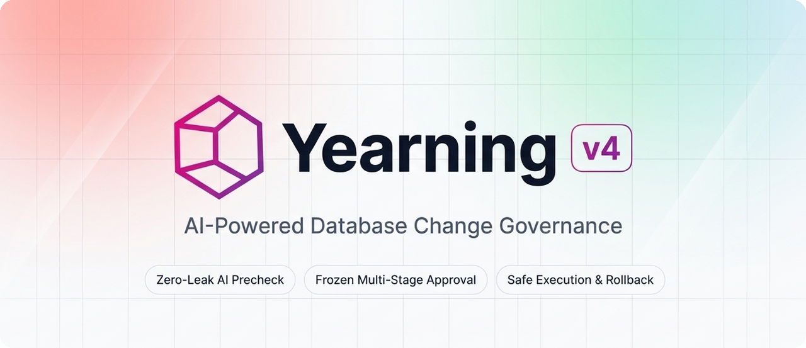
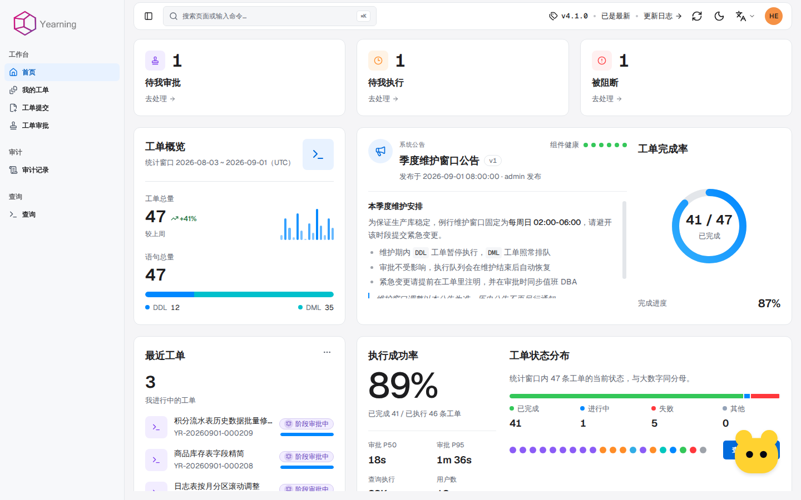
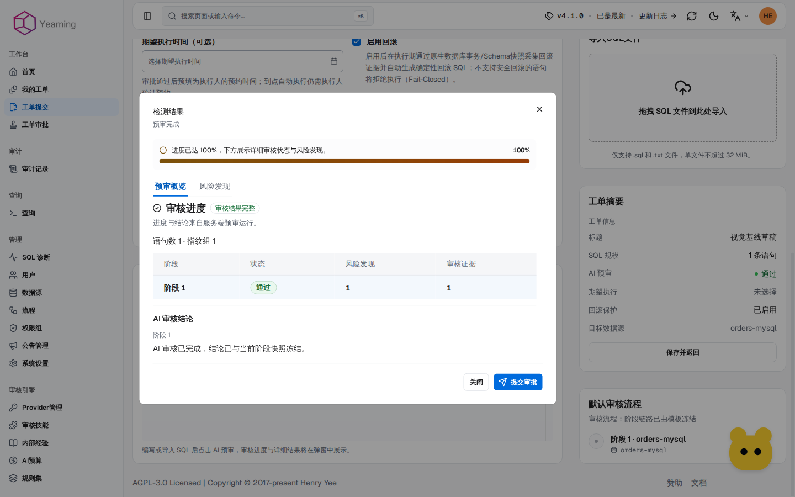
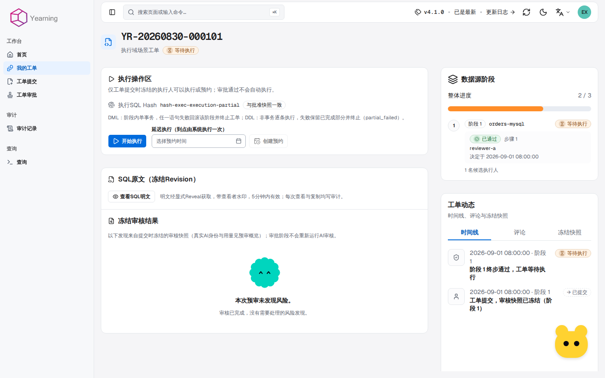
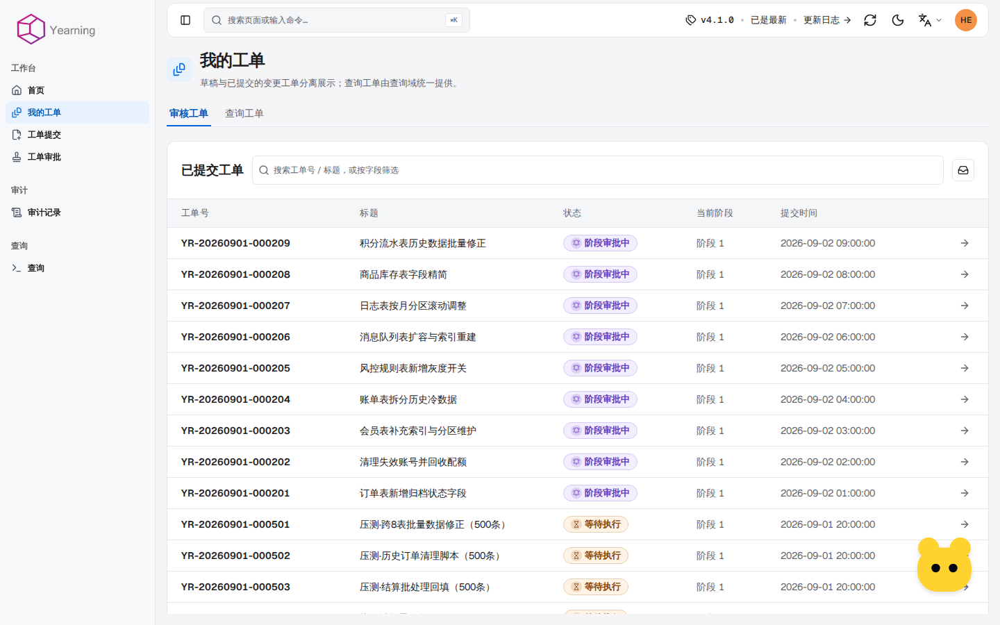
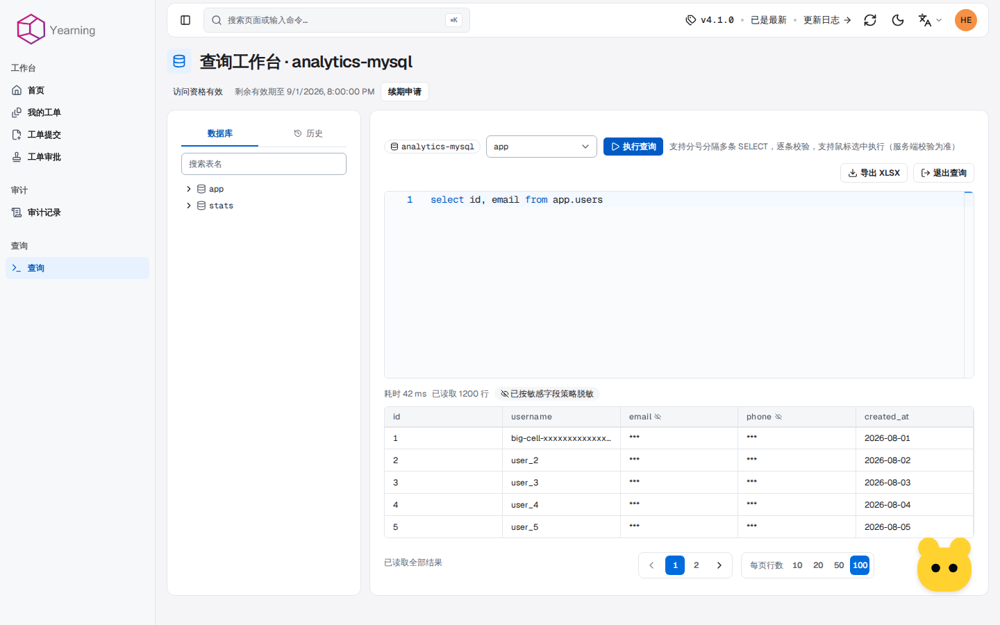
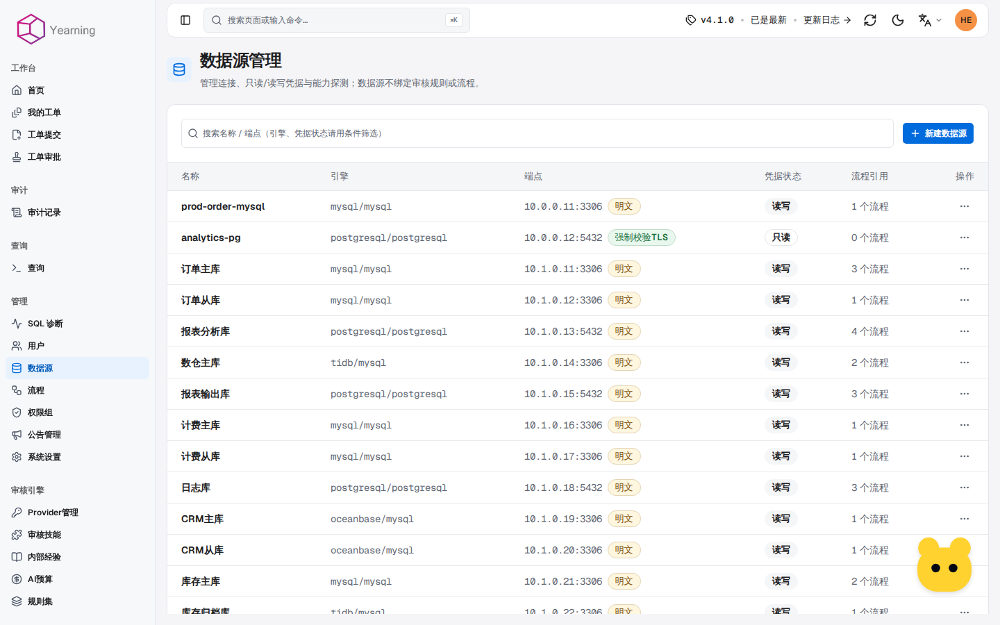
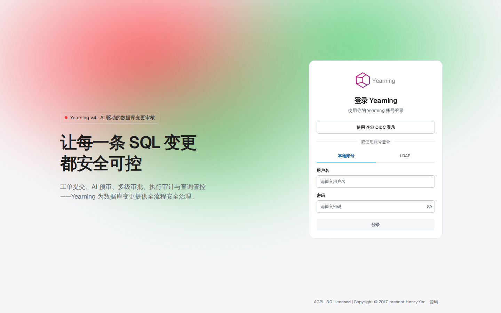
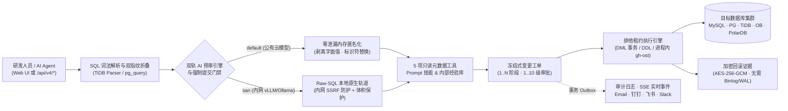

<div align="center"><a name="readme-top"></a>

<a href="https://v4.yearning.io" target="_blank">
  <picture>
    <source media="(prefers-color-scheme: dark)" srcset="./assets/readme/hero-banner-dark.png">
    
  </picture>
</a>

# Yearning

**AI 驱动的企业级数据库变更治理与 SQL 审核平台**

让每一条 SQL 变更都安全可控。<br/>
从零泄漏 AI 预审与冻结式多阶段审批，到进程内 `gh-ost` 在线 DDL、跨引擎自动回滚、受控只读查询与 SQL 性能诊断，全面守护生产数据库生命周期。

[English](./README.md) · **简体中文** · [在线演示][demo-link] · [官方文档][docs-link] · [版本发布][github-release-link] · [社区讨论][github-discussions-link] · [问题反馈][github-issues-link] · [赞助支持][sponsor-link]

<br/>

[![][demo-shield-badge]][demo-link] [![][docs-shield-badge]][docs-link]

<!-- SHIELD GROUP -->

[![][github-release-shield]][github-release-link]
[![][docker-ghcr-shield]][docker-ghcr-link]
[![][go-version-shield]][go-version-link]
[![][react-version-shield]][react-version-link]
[![][postgres-shield]][postgres-link]<br/>
[![][github-stars-shield]][github-stars-link]
[![][github-forks-shield]][github-forks-link]
[![][github-issues-shield]][github-issues-link]
[![][github-contributors-shield]][github-contributors-link]
[![][github-license-shield]][github-license-link]<br/>

**分享 Yearning 仓库**

[![][share-x-shield]][share-x-link]
[![][share-telegram-shield]][share-telegram-link]
[![][share-whatsapp-shield]][share-whatsapp-link]
[![][share-reddit-shield]][share-reddit-link]
[![][share-weibo-shield]][share-weibo-link]
[![][share-linkedin-shield]][share-linkedin-link]

</div>

<details>
<summary><kbd>目录导航</kbd></summary>

#### TOC

- [👋🏻 快速了解与加入社区](#-快速了解与加入社区)
- [✨ 核心特性](#-核心特性)
  - [让每一条 SQL 变更都安全可控](#让每一条-sql-变更都安全可控)
  - [`01` 零泄漏 AI SQL 预审与提交门禁](#01-零泄漏-ai-sql-预审与提交门禁)
  - [`02` 冻结式多阶段审批与安全执行控制](#02-冻结式多阶段审批与安全执行控制)
  - [`03` 跨引擎无 Binlog/WAL 自动 SQL 回滚](#03-跨引擎无-binlogwal-自动-sql-回滚)
  - [`04` 受控只读查询工作台与敏感字段脱敏](#04-受控只读查询工作台与敏感字段脱敏)
  - [`05` SQL 性能诊断与受控数据库 AI 助手](#05-sql-性能诊断与受控数据库-ai-助手)
  - [`06` 多引擎治理、企业级 SSO 与通知中心](#06-多引擎治理企业级-sso-与通知中心)
- [🏗️ 架构设计与隐私流水线](#-架构设计与隐私流水线)
- [🗄️ 支持的数据库引擎矩阵](#-支持的数据库引擎矩阵)
- [🤖 AI Agent Skill 与 OpenAPI](#-ai-agent-skill-与-openapi)
- [🛳 私有化部署](#-私有化部署)
  - [`A` Docker Compose 一键部署（推荐）](#a-docker-compose-一键部署推荐)
  - [`B` Kubernetes 生产级多副本部署](#b-kubernetes-生产级多副本部署)
  - [`C` 从 Yearning v3 升级迁移](#c-从-yearning-v3-升级迁移)
- [⌨️ 本地开发](#-本地开发)
- [🤝 参与贡献](#-参与贡献)
- [🔐 安全策略](#-安全策略)
- [❤️ 赞助支持](#-赞助支持)
- [📝 开源许可](#license)

####

<br/>

</details>

<br/>

<div align="center">
  <picture>
    <source media="(prefers-color-scheme: dark)" srcset="./frontend/tests/screenshots/dashboard-1440-zh-CN-dark.png">
    
  </picture>
</div>

## 👋🏻 快速了解与加入社区

**Yearning v4** 是开源 SQL 审核与数据库治理平台 Yearning 的彻底重构版本。基于单二进制 **Go 模块化单体后端**、全新 **React 19 + shadcn/ui** 前端工作台与 **PostgreSQL** 元数据库构建，彻底移除旧版 RPC 服务，带来 **零泄漏 AI SQL 预审引擎**、提交即冻结的多阶段审批流、内置进程内 `gh-ost` 在线 DDL、跨引擎无 Binlog/WAL 自动回滚、受控只读查询脱敏以及 Top SQL 性能诊断。

无论您是守护生产数据库的 DBA、规范发布流程的研发效能团队，还是希望让 AI Coding Agent 通过 `/api/v4/*` 安全接入数据库治理体系的工程团队，Yearning v4 都能为您提供结构化、可审计、不可绕过的全生命周期安全管控。

| 社区渠道 | 说明 |
| :-- | :-- |
| [![][demo-shield-badge]][demo-link] | 免部署浏览器端在线演示站（含 AI SQL 预审、数据库 AI 助手、SQL 性能诊断与多角色视角切换）：**demo.yearning.io**。 |
| [![][docs-shield-badge]][docs-link] | 官方安装指南、架构说明、安全模型与运维文档：**v4.yearning.io**。 |
| [![][discussions-shield-badge]][github-discussions-link] | 在 GitHub Discussions 交流部署经验、自定义审核技能与架构实践。 |
| [![][issues-shield-badge]][github-issues-link] | 提交缺陷反馈、数据库引擎适配建议或新需求。 |
| [![][email-shield-badge]][email-link] | 商业授权、企业级支持与合作联系：**henry@yearning.io**。 |

> [!IMPORTANT]
>
> **点亮 Star**，第一时间获取 Yearning v4 每一个版本更新与发布动态！⭐️

<details>
  <summary><kbd>Star History</kbd></summary>
  <picture>
    <source media="(prefers-color-scheme: dark)" srcset="https://api.star-history.com/svg?repos=cookieY%2FYearning&theme=dark&type=Date">
    
  </picture>
</details>

<div align="right">

[![][back-to-top]](#readme-top)

</div>

## ✨ 核心特性

<div align="center">

### 让每一条 SQL 变更都安全可控

AI 负责风险识别与证据综合，结构化治理流程掌控每一次审批、执行与审计闭环。

<sub>YEARNING V4 核心能力</sub>

</div>

<table>
  <tr>
    <td width="50%" valign="top">
      <b>🛡️ 零泄漏 AI SQL 预审</b><br/>
      结构化指纹折叠最高 10 万条 SQL，剥离字面值与注释并在内存完成标识符匿名化，强制执行不可绕过的提交门禁。
    </td>
    <td width="50%" valign="top">
      <b>🔒 冻结式多阶段审批治理</b><br/>
      支持 <code>1..N</code> 串行数据源阶段与每阶段 <code>1..10</code> 级审批，提交即由服务端冻结快照，包括 <code>admin</code> 在内均不可绕过或篡改。
    </td>
  </tr>
  <tr>
    <td width="50%" valign="top">
      <b>⚡ 进程内 <code>gh-ost</code> 与跨引擎回滚</b><br/>
      Go 进程内嵌 <code>gh-ost</code> 实时展示拷贝进度；无需 Binlog/WAL 即可在 MySQL 与 PostgreSQL 自动捕获前像并生成受治理回滚工单。
    </td>
    <td width="50%" valign="top">
      <b>🔍 受控只读查询与性能诊断</b><br/>
      限时只读查询授权 + 服务端敏感列脱敏 + 流式导出；内置 6 图联动 Top SQL 性能趋势与四段式 AI 根因优化诊断。
    </td>
  </tr>
</table>

---

### `01` 零泄漏 AI SQL 预审与提交门禁

每一份 DDL/DML 变更工单在提交前都必须通过「确定性语法/规则检测 + AI 深度审查」双阶段预审。系统支持单次最高 **100,000 条语句 / 32 MiB** SQL 批量导入，自动计算 **Canonical / Dialect 双指纹**并将同构语句折叠分组（单工单最多 **1,000 组**不同模板），仅向 AI 发送每组 **1 条代表性脱敏 SQL**。

- **5 项只读元数据工具**：AI 审核代理通过 `check_syntax`、`describe_table`、`list_indexes`、`table_stats`、`safe_explain` 实时探测真实表结构、索引选择率与执行计划，绝不写入任何业务数据。
- **双轨 AI 隐私隔离架构**：
  - **`default` 轨道（公有云 OpenAI 兼容模型）**：请求级内存匿名化全部表名、列名与字面值（`schema_1`、`table_1`、`column_1`），经零泄漏断言后发出；授权阅读者在页面查看结果时由服务端自动还原真实对象名并记录审计日志。
  - **`san` 轨道（内网自部署本地模型，如 vLLM / Ollama）**：针对内网 RFC1918 地址启用精简 Raw-SQL 原生契约与 SSRF 防护（`addrguard`），严格隔离双轨边界，确保原始 SQL 绝不回退泄漏至公有云 Provider。
- **自定义审核技能与内部经验库**：自由编排内置与自定义 Prompt 技能、维护 `全局 / 数据源 / 表级` DBA 内部经验规则；任何启用的规则命中或可信运行时证明的无效执行一律归为 `Critical` 并阻断提交。
- **全局单日 AI 费用预算**：支持按多时段 `CNY` / `USD` 参考计价配置全局单日预算及同契约主备 Provider 容灾切换。

<picture>
  <source media="(prefers-color-scheme: dark)" srcset="./frontend/tests/screenshots/precheck-1440-zh-CN-dark.png">
  
</picture>

<div align="right">

[![][back-to-top]](#readme-top)

</div>

### `02` 冻结式多阶段审批与安全执行控制

面向团队真实发布链路，按权限组灵活配置 `change_review` 变更流程：每条流程支持 **`1..N` 个串行数据源阶段**（如预发 → 生产）、每阶段 **`1..10` 个串行审批节点** 及明确的执行人列表。

- **提交即冻结**：审核规则、阶段链路、数据源身份、审批人、执行人、SQL 哈希与全部阶段 AI 审核快照由服务端统一冻结。任何角色（含内置 `admin`）均不可修改已提交工单的审批链或越权代审、代执行。
- **带水印受控 SQL 明文揭示（Reveal）**：工单 SQL 原文以 **AES-256-GCM** 加密存储，常规列表与详情仅返回元数据；查看明文需显式触发 Reveal，页面叠加可追溯水印（`用户名 + 时间戳 + Trace ID`）并写入二次审计日志。
- **可控执行与进程内 `gh-ost` 在线改表**：
  - **审批通过不自动执行**：仅当前阶段冻结执行人可点击立即执行或创建预约执行（支持 15 分钟预约宽限窗口与每周允许执行时段约束）。
  - **单数据源排他执行租约**：避免同一数据库并发变更互相干扰。
  - **内置进程内 `gh-ost`**：针对原生 MySQL 5.7+（`5.7 / 8.0 / 8.4 LTS`）大表 `ALTER TABLE` 直接在 Go 进程内调用 `gh-ost`，提供 18 项安全限流与切换参数及实时表拷贝进度，无需部署外部二进制。
  - **失败关闭与 `result_unknown` 人工核验**：提交瞬间遇网络中断绝不盲目自动重放，由冻结执行人核验真实库状态后提交带永久审计标记的核验结论。

<picture>
  <source media="(prefers-color-scheme: dark)" srcset="./frontend/tests/screenshots/detail-1440-zh-CN-dark.png">
  
</picture>

<picture>
  <source media="(prefers-color-scheme: dark)" srcset="./frontend/tests/screenshots/list-1440-zh-CN-dark.png">
  
</picture>

<div align="right">

[![][back-to-top]](#readme-top)

</div>

### `03` 跨引擎无 Binlog/WAL 自动 SQL 回滚

Yearning v4 彻底摆脱对 MySQL Binlog 抓取的依赖，采用 **跨引擎 AST 逆向生成 + 事务内前像快照机制**，同时覆盖 MySQL 兼容族与 PostgreSQL 兼容族。

- **事务内 DML 前像采集**：执行 `INSERT` / `UPDATE` / `DELETE` 时在同一数据库事务内精准捕获受影响行前像（单语句及单工单上限 **100,000 行**；开启回滚保护且超限时自动回滚正向事务，绝不在缺少完整回滚证据的情况下提交）。
- **DDL 与 `gh-ost` 结构回滚**：自动记录建表/删表、增删改列、重命名、索引、约束及 `gh-ost` 改表前后元数据并重建逆向 DDL。
- **受治理回滚工单**：逆向 SQL 以 `AES-256-GCM` 加密落盘，支持受控 Reveal 审查并一键派生关联回滚工单，重新走完 AI 预审、审批与漂移校验后安全执行。

<div align="right">

[![][back-to-top]](#readme-top)

</div>

### `04` 受控只读查询工作台与敏感字段脱敏

无需向研发或分析师分发数据库明文账号，即可提供高效、合规、全审计的自助只读查询体验。

- **限时访问授权（Query Grant）**：通过 `query_access` 流程申请指定数据源与有效期（或关闭审批直连受控会话）；审批人或管理员可随时一键撤销访问权，并通过 **SSE（`GET /api/v4/events/stream`）** 实时推送锁定前端查询工作台。
- **严格只读 AST 安全校验**：仅放行 `SELECT`、`WITH ... SELECT`、`SHOW`、`DESCRIBE`、`EXPLAIN`，在只读事务中执行并支持配置语句超时（`1..300,000 ms`）。
- **服务端敏感列脱敏**：按流程配置敏感字段脱敏策略，邮箱、手机号等 PII 数据在离开服务端前即完成脱敏。
- **流式游标与受控导出**：HMAC 签名游标分页（单页最高 **5,000 行**，**6 小时 TTL**），内置 Monaco 表结构自动补全；按数据源独立授权 `can_export`，支持浏览器端增量导出 **XLSX / CSV / JSONL**。

<picture>
  <source media="(prefers-color-scheme: dark)" srcset="./frontend/tests/screenshots/query-1440-zh-CN-dark.png">
  
</picture>

<div align="right">

[![][back-to-top]](#readme-top)

</div>

### `05` SQL 性能诊断与受控数据库 AI 助手

- **SQL 性能诊断（`/admin/diagnostics`）**：
  - 严格复用只读连接池采集 MySQL **`performance_schema`** 与 PostgreSQL **`pg_stat_statements`** 语句指纹统计，绝不自动安装扩展或重置计数器。
  - **6 图联动性能总览**（总耗时、调用次数、平均延迟、扫描行数/共享块读取、锁等待、错误/告警），支持拖动 **Brush 时间刷**精准下钻毛刺窗口与 Top SQL 排行。
  - **四段式 AI 性能诊断报告**：针对热点指纹输出 **根因分析、索引建议、SQL 改写建议、验证步骤**，推荐的建索引 DDL 可一键送入 AI 预审并提交变更工单。
- **受控数据库 AI 助手**：
  - 严格聚焦三大数据库场景：**① 平台使用与治理咨询**、**② 基于只读元数据的自然语言生成 SQL**、**③ SQL 分析与优化建议**。
  - 每次调用执行请求级内存脱敏与 AST 结构化还原，不查询业务表行数据、不直接执行任何 SQL；生成的变更草稿必须通过正式 AI 预审与审批方可提交。

<div align="right">

[![][back-to-top]](#readme-top)

</div>

### `06` 多引擎治理、企业级 SSO 与通知中心

- **多引擎数据源注册中心**：统一纳管 MySQL、PostgreSQL、TiDB、OceanBase、PolarDB 实例，分离 **只读（审核/查询）** 与 **读写（执行）** 凭据，支持强制校验 TLS 证书与 AEAD 加密存储。
- **企业级身份认证**：支持本地账号、**LDAP（强制 `LDAPS` / `StartTLS` 证书校验）** 及多实例 **OIDC SSO（Authorization Code + PKCE `S256`）**。
- **通知中心**：基于事务 Outbox 可靠投递 **Email（SMTP）、钉钉、飞书、Slack**，支持规则化路由、白名单变量模板、发送前预览、消息去重与 5 次指数退避重试，结构上杜绝原始 SQL 与敏感凭据外泄。
- **完整合规审计**：90 天追加写审计日志覆盖登录、预审、对象名还原、SQL 明文查看、审批、执行、回滚、查询、导出与后台配置变更；工单、审批与执行事实永久保留。

<picture>
  <source media="(prefers-color-scheme: dark)" srcset="./frontend/tests/screenshots/admin-1440-zh-CN-dark.png">
  
</picture>

<picture>
  <source media="(prefers-color-scheme: dark)" srcset="./frontend/tests/screenshots/login-zh-CN-dark.png">
  
</picture>

<div align="right">

[![][back-to-top]](#readme-top)

</div>

## 🏗️ 架构设计与隐私流水线

Yearning v4 采用 **无状态 Go 模块化单体 + PostgreSQL** 架构，零 RPC 依赖、零本地 Pod 状态，天然支持 Kubernetes 水平多副本扩展。



| 技术层次 | 技术栈 |
| :-- | :-- |
| **后端服务** | Go `1.26` · Gin · GORM · `pgx/v5` · TiDB SQL Parser · `pg_query_go/v6` · 进程内 `gh-ost` · 零 RPC |
| **前端应用** | React `19` · TypeScript `6` · Vite `8` · Tailwind CSS `v4` · shadcn/ui · Base UI · Monaco Editor · Recharts |
| **存储与安全** | PostgreSQL `14–18` · AES-256-GCM AEAD 密钥环 · 双提交 CSRF · OIDC PKCE (`S256`) · LDAPS/StartTLS |
| **交付形态** | Distroless 非 root 只读镜像（`linux/amd64`、`linux/arm64`）· Kubernetes 多副本原生就绪 |

<div align="right">

[![][back-to-top]](#readme-top)

</div>

## 🗄️ 支持的数据库引擎矩阵

| 数据库引擎 | 兼容模式 | AI SQL 预审 | 变更执行 | 进程内 `gh-ost` | 自动回滚 | 受控查询 | SQL 性能诊断 |
| :-- | :-- | :-: | :-: | :-: | :-: | :-: | :-: |
| **MySQL 5.7+ (5.7 / 8.0 / 8.4 LTS)** | 原生 MySQL | ✅ | ✅ | ✅ | ✅ | ✅ | ✅ (`performance_schema`) |
| **PostgreSQL 14+** | 原生 PostgreSQL | ✅ | ✅ | — | ✅ | ✅ | ✅ (`pg_stat_statements`) |
| **TiDB** | MySQL 模式 | ✅ | ✅ | — | ✅ | ✅ | ✅ |
| **OceanBase** | MySQL 模式 | ✅ | ✅ | — | ✅ | ✅ | ✅ |
| **PolarDB** | MySQL &amp; PG 模式 | ✅ | ✅ | — | ✅ | ✅ | ✅ |

> [!NOTE]
>
> Yearning v4 自身元数据库正式采用 **PostgreSQL**（`docker-compose.yml` 已预置 PostgreSQL 18 开箱即用）。

<div align="right">

[![][back-to-top]](#readme-top)

</div>

## 🤖 AI Agent Skill 与 OpenAPI

Yearning v4 原生提供完整 **OpenAPI 3 规范**（[`api/openapi/yearning-v4.yaml`](./api/openapi/yearning-v4.yaml)）、**实时 SSE 事件流**（`GET /api/v4/events/stream`）以及零依赖的开放 **`SKILL.md` Agent 技能包**（[`skills/yearning/`](./skills/yearning/SKILL.md)），可直接接入 **Claude Code**、**Codex CLI**、**Antigravity** 等主流 AI 编程助手，无需额外搭建 MCP 服务。

| 能力 | 仓库路径 | 用途说明 |
| :-- | :-- | :-- |
| **🧠 Agent Skill (`SKILL.md`)** | [`skills/yearning/SKILL.md`](./skills/yearning/SKILL.md) | 让 AI Agent 在严格 RBAC 与预审门禁约束下发现流程、发起 AI 预审、提交/审批/执行工单、执行受控只读查询与性能诊断。 |
| **🐍 零依赖 Python CLI 助手** | [`skills/yearning/scripts/yearning_api.py`](./skills/yearning/scripts/yearning_api.py) | 基于 Python 3 标准库，自动处理登录 Cookie、双提交 `X-CSRF-Token`、`Idempotency-Key`、`If-Match` 乐观锁与受控 SQL Reveal。 |
| **📜 OpenAPI 3 规范** | [`api/openapi/yearning-v4.yaml`](./api/openapi/yearning-v4.yaml) | 生成强类型 SDK、对接企业 CI/CD 发布系统，或通过 `GET /api/v4/events/stream` 订阅用户级 `io.yearning.v4.*` 实时状态变更。 |

```bash
export YEARNING_BASE_URL="http://localhost:8080"
export YEARNING_USERNAME="admin"
export YEARNING_PASSWORD_FILE="/path/to/password"

# 查询已授权流程并运行 AI SQL 预审
python3 skills/yearning/scripts/yearning_api.py flows
python3 skills/yearning/scripts/yearning_api.py precheck \
  --flow-id <flow_id> \
  --sql "ALTER TABLE demo.users ADD COLUMN status VARCHAR(32) NOT NULL DEFAULT 'active';"

# 执行受控只读 SELECT 查询（服务端自动应用敏感列脱敏）
python3 skills/yearning/scripts/yearning_api.py query \
  --datasource-id <datasource_id> \
  --schema-name app \
  --sql "SELECT id, email, created_at FROM users LIMIT 20"
```

<div align="right">

[![][back-to-top]](#readme-top)

</div>

## 🛳 私有化部署

将 Yearning v4 完整部署至自有基础设施，所有表结构、凭据密钥与审计轨迹均留存在企业内网边界之中。

### `A` Docker Compose 一键部署（推荐）

[![][docker-ghcr-shield]][docker-ghcr-link]

仓库内置的 [`docker-compose.yml`](./docker-compose.yml) 开箱即用地拉起 **PostgreSQL 18**、内部 TLS 证书自动签发、**AES-256-GCM AEAD 密钥环**、自动 Schema 迁移以及内置 Web UI 的 Yearning v4 控制面，无需手工拼装密钥文件。

```bash
git clone --single-branch --branch v4 https://github.com/cookieY/Yearning.git
cd Yearning
docker compose up -d
```

启动完成后在浏览器打开 **`http://<你的服务器IP>:8080`**：

- **默认管理员账号**：`admin`
- **默认初始密码**：`Yearning@2026!` *（首次启动前可通过环境变量 `YEARNING_ADMIN_PASSWORD` 自定义，至少 12 位）*

> [!CAUTION]
>
> **版本升级时切勿执行 `docker compose down -v`**：删除 `yearning_app_secrets` 卷会永久销毁 AEAD 加密密钥环，导致已保存的数据源密码、AI Provider 密钥与加密工单 SQL 无法解密。
>
> 生产环境请将 Yearning 置于 HTTPS 反向代理之后，设置 `YEARNING_SESSION_SECURE=true`，并参考 [`db/roles/grants.sql`](./db/roles/grants.sql) 启用 PostgreSQL 三角色最小权限隔离。

### `B` Kubernetes 生产级多副本部署

仓库内置符合安全加固规范（Distroless、非 root、只读根文件系统）的 Kubernetes 清单（[`backend/deploy/k8s/`](./backend/deploy/k8s/)）：

- [`backend/deploy/k8s/control-plane.yaml`](./backend/deploy/k8s/control-plane.yaml) — 无状态多副本 Deployment，内置健康探针与最小安全上下文。
- [`backend/deploy/k8s/migration-workloads.yaml`](./backend/deploy/k8s/migration-workloads.yaml) — 独立 Schema 迁移 Job，与运行时加密密钥卷隔离。
- [`backend/deploy/k8s/network-policy.yaml`](./backend/deploy/k8s/network-policy.yaml) — 最小权限集群 NetworkPolicy 策略。

### `C` 从 Yearning v3 升级迁移

Yearning v4 提供显式、版本化的停机迁移工具链（`yearning migrate` 与 [`api/migration/`](./api/migration/)），支持迁移前 Dry-Run 演练与权限映射确认工作台（`yearning serve --migration-mode`），杜绝静默 AutoMigrate 与双写污染。升级前请先查阅[官方迁移指南][docs-link]。

<div align="right">

[![][back-to-top]](#readme-top)

</div>

## ⌨️ 本地开发

### 环境要求

- **Go** `1.26+`
- **Node.js** `24.x` 与 **pnpm** `10.x`
- **PostgreSQL** `14–18`（运行完整后端服务时需要）

### 构建与测试

```bash
# 克隆 v4 分支
git clone --single-branch --branch v4 https://github.com/cookieY/Yearning.git
cd Yearning

# 后端编译与单元测试
make backend-build
make backend-test

# 前端依赖安装、构建与测试
make frontend-install
make frontend-build
make frontend-test

# 构建独立发布容器镜像
make docker-build
```

### 仓库目录结构

| 目录 | 说明 |
| :-- | :-- |
| [`backend/`](./backend/README.md) | Go 模块化单体后端（`cmd/yearning`、`internal/`、`deploy/k8s/`） |
| [`frontend/`](./frontend/README.md) | React 19 + TypeScript + Vite + Tailwind CSS v4 + shadcn/ui 前端应用 |
| [`db/`](./db/) | 版本化 PostgreSQL Schema 迁移脚本（`db/migrations/`）与最小权限角色授权（`db/roles/grants.sql`） |
| [`api/`](./api/) | OpenAPI 3 契约（`api/openapi/yearning-v4.yaml`）、迁移字段映射与运行时契约 |
| [`docker/`](./docker/) 与 [`docker-compose.yml`](./docker-compose.yml) | Distroless 多架构发布 Dockerfile 与一体化 Docker Compose 编排 |
| [`skills/yearning/`](./skills/yearning/SKILL.md) | 面向 `/api/v4/*` 的零依赖 AI Agent Skill（`SKILL.md` + Python 助手脚本） |

<div align="right">

[![][back-to-top]](#readme-top)

</div>

## 🤝 参与贡献

欢迎所有形式的社区贡献——缺陷修复、新数据库方言适配、界面体验优化、文档完善与审核技能分享！

提交 Pull Request 前，请先阅读 [**贡献指南（CONTRIBUTING.md）**](./CONTRIBUTING.md) 与 [**贡献者许可协议（CLA.md）**](./CLA.md)。

[![][pr-welcome-shield]][pr-welcome-link]
[![][issues-shield-badge]][github-issues-link]

<a href="https://github.com/cookieY/Yearning/graphs/contributors" target="_blank">
  
</a>

<div align="right">

[![][back-to-top]](#readme-top)

</div>

## 🔐 安全策略

安全是 Yearning v4 的立身之本。如果您发现任何安全漏洞，**请勿直接提交公开 Issue**，请按照 [`SECURITY.md`](./SECURITY.md) 指引私密报告维护团队以便及时响应修复。

<div align="right">

[![][back-to-top]](#readme-top)

</div>

## ❤️ 赞助支持

Yearning 自 2017 年起坚持开源维护至今。如果 Yearning 为您的团队守住了每一次生产数据库变更的安全底线，欢迎赞助支持项目持续演进！

[![][sponsor-shield-badge]][sponsor-link]

如需商业授权、企业级技术支持或私有化部署咨询，请联系 **<henry@yearning.io>**。

<div align="right">

[![][back-to-top]](#readme-top)

</div>

---

<a id="license"></a>

<details><summary><h4>📝 开源许可</h4></summary>

Yearning v4 采用双许可模式：

- **开源协议**：基于 **GNU Affero General Public License v3.0 or later（[AGPL-3.0-or-later](./LICENSE)）** 发布。任何二次开发、修改版本或基于网络提供服务的部署，均须严格遵守 AGPL-3.0 协议要求（含第 13 条源码提供义务）。
- **商业授权**：如需闭源定制、去除 AGPL 传染条款或获取企业 SLA 支持，请联系 **<henry@yearning.io>** 获取独立商业授权。

</details>

Copyright © 2017–2026 [Henry Yee][profile-link]. <br />
本项目基于 [AGPL-3.0-or-later](./LICENSE) 开源许可发布。

<!-- LINK GROUP -->

[back-to-top]: https://img.shields.io/badge/-BACK_TO_TOP-151515?style=flat-square
[demo-link]: https://demo.yearning.io
[demo-shield-badge]: https://img.shields.io/badge/🚀_在线演示-demo.yearning.io-a855f7?labelColor=black&style=for-the-badge
[discussions-shield-badge]: https://img.shields.io/badge/💬_GitHub_Discussions-181717?style=for-the-badge&logo=github&logoColor=white
[docker-ghcr-link]: https://github.com/cookieY/Yearning/pkgs/container/yearning
[docker-ghcr-shield]: https://img.shields.io/badge/ghcr.io-yearning%3Av4-369eff?labelColor=black&logo=docker&logoColor=white&style=flat-square
[docs-link]: https://v4.yearning.io
[docs-shield-badge]: https://img.shields.io/badge/📖_官方文档-v4.yearning.io-d946ef?labelColor=black&style=for-the-badge
[email-link]: mailto:henry@yearning.io
[email-shield-badge]: https://img.shields.io/badge/✉️_联系作者-henry%40yearning.io-6366f1?labelColor=black&style=for-the-badge
[github-contributors-link]: https://github.com/cookieY/Yearning/graphs/contributors
[github-contributors-shield]: https://img.shields.io/github/contributors/cookieY/Yearning?color=c4f042&labelColor=black&style=flat-square
[github-discussions-link]: https://github.com/cookieY/Yearning/discussions
[github-forks-link]: https://github.com/cookieY/Yearning/network/members
[github-forks-shield]: https://img.shields.io/github/forks/cookieY/Yearning?color=8ae8ff&labelColor=black&style=flat-square
[github-issues-link]: https://github.com/cookieY/Yearning/issues
[github-issues-shield]: https://img.shields.io/github/issues/cookieY/Yearning?color=ff80eb&labelColor=black&style=flat-square
[github-license-link]: ./LICENSE
[github-license-shield]: https://img.shields.io/badge/license-AGPL--3.0-white?labelColor=black&style=flat-square
[github-release-link]: https://github.com/cookieY/Yearning/releases
[github-release-shield]: https://img.shields.io/github/v/release/cookieY/Yearning?include_prereleases&color=369eff&labelColor=black&logo=github&style=flat-square
[github-stars-link]: https://github.com/cookieY/Yearning/stargazers
[github-stars-shield]: https://img.shields.io/github/stars/cookieY/Yearning?color=ffcb47&labelColor=black&style=flat-square
[go-version-link]: https://go.dev/
[go-version-shield]: https://img.shields.io/badge/Go-1.26-00ADD8?labelColor=black&logo=go&logoColor=white&style=flat-square
[issues-shield-badge]: https://img.shields.io/badge/🐛_提交_Issue-%E2%86%92-ff80eb?labelColor=black&style=for-the-badge
[postgres-link]: https://www.postgresql.org/
[postgres-shield]: https://img.shields.io/badge/PostgreSQL-14--18-4169E1?labelColor=black&logo=postgresql&logoColor=white&style=flat-square
[pr-welcome-link]: https://github.com/cookieY/Yearning/pulls
[pr-welcome-shield]: https://img.shields.io/badge/🤝_欢迎_PR-%E2%86%92-ffcb47?labelColor=black&style=for-the-badge
[profile-link]: https://github.com/cookieY
[react-version-link]: https://react.dev/
[react-version-shield]: https://img.shields.io/badge/React-19-61DAFB?labelColor=black&logo=react&logoColor=white&style=flat-square
[share-linkedin-link]: https://www.linkedin.com/sharing/share-offsite/?url=https%3A%2F%2Fgithub.com%2FcookieY%2FYearning
[share-linkedin-shield]: https://img.shields.io/badge/-share%20on%20linkedin-black?labelColor=black&logo=linkedin&logoColor=white&style=flat-square
[share-reddit-link]: https://www.reddit.com/submit?title=Yearning%20v4%20%E2%80%94%20AI-Powered%20Database%20Change%20Governance%20%26%20SQL%20Review%20Platform&url=https%3A%2F%2Fgithub.com%2FcookieY%2FYearning
[share-reddit-shield]: https://img.shields.io/badge/-share%20on%20reddit-black?labelColor=black&logo=reddit&logoColor=white&style=flat-square
[share-telegram-link]: https://t.me/share/url?url=https%3A%2F%2Fgithub.com%2FcookieY%2FYearning&text=Yearning%20v4%20%E2%80%94%20AI%20%E9%A9%B1%E5%8A%A8%E7%9A%84%E6%95%B0%E6%8D%AE%E5%BA%93%E5%8F%98%E6%9B%B4%E6%B2%BB%E7%90%86%E4%B8%8E%20SQL%20%E5%AE%A1%E6%A0%B8%E5%B9%B3%E5%8F%B0
[share-telegram-shield]: https://img.shields.io/badge/-share%20on%20telegram-black?labelColor=black&logo=telegram&logoColor=white&style=flat-square
[share-weibo-link]: https://service.weibo.com/share/share.php?title=Yearning%20v4%20%E2%80%94%20AI%20%E9%A9%B1%E5%8A%A8%E7%9A%84%E6%95%B0%E6%8D%AE%E5%BA%93%E5%8F%98%E6%9B%B4%E6%B2%BB%E7%90%86%E4%B8%8E%20SQL%20%E5%AE%A1%E6%A0%B8%E5%B9%B3%E5%8F%B0&url=https%3A%2F%2Fgithub.com%2FcookieY%2FYearning
[share-weibo-shield]: https://img.shields.io/badge/-share%20on%20weibo-black?labelColor=black&logo=sinaweibo&logoColor=white&style=flat-square
[share-whatsapp-link]: https://api.whatsapp.com/send?text=Yearning%20v4%20%E2%80%94%20AI%20%E9%A9%B1%E5%8A%A8%E7%9A%84%E6%95%B0%E6%8D%AE%E5%BA%93%E5%8F%98%E6%9B%B4%E6%B2%BB%E7%90%86%E4%B8%8E%20SQL%20%E5%AE%A1%E6%A0%B8%E5%B9%B3%E5%8F%B0%20https%3A%2F%2Fgithub.com%2FcookieY%2FYearning
[share-whatsapp-shield]: https://img.shields.io/badge/-share%20on%20whatsapp-black?labelColor=black&logo=whatsapp&logoColor=white&style=flat-square
[share-x-link]: https://x.com/intent/tweet?hashtags=SQL%2CDatabase%2CDevOps%2CAI&text=Yearning%20v4%20%E2%80%94%20AI%20%E9%A9%B1%E5%8A%A8%E7%9A%84%E5%BC%80%E6%BA%90%E6%95%B0%E6%8D%AE%E5%BA%93%E5%8F%98%E6%9B%B4%E6%B2%BB%E7%90%86%E4%B8%8E%20SQL%20%E5%AE%A1%E6%A0%B8%E5%B9%B3%E5%8F%B0%EF%BC%8C%E6%94%AF%E6%8C%81%20MySQL%2FPostgreSQL%2FTiDB%2FOceanBase%2FPolarDB%E3%80%82&url=https%3A%2F%2Fgithub.com%2FcookieY%2FYearning
[share-x-shield]: https://img.shields.io/badge/-share%20on%20x-black?labelColor=black&logo=x&logoColor=white&style=flat-square
[sponsor-link]: https://next.yearning.io/zh/about/w5jt71jw/
[sponsor-shield-badge]: https://img.shields.io/badge/❤️_赞助_Yearning-%E2%86%92-ff4d6d?labelColor=black&style=for-the-badge
